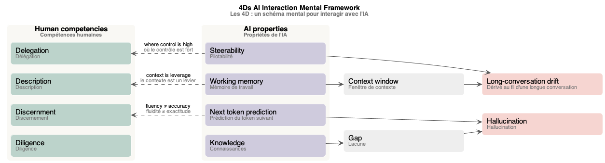
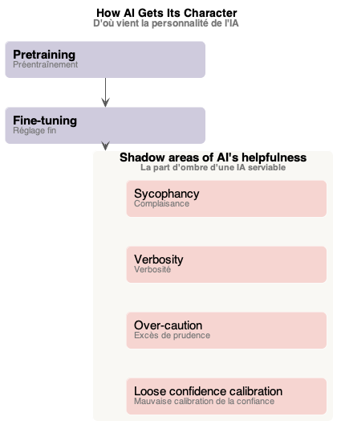
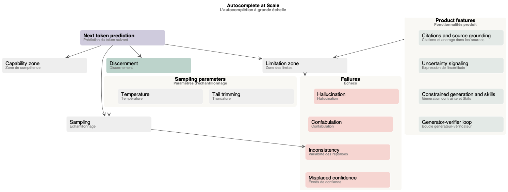
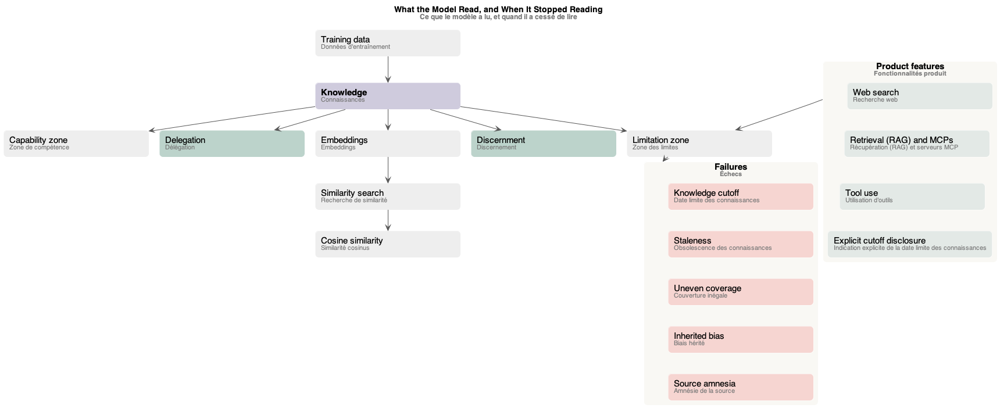
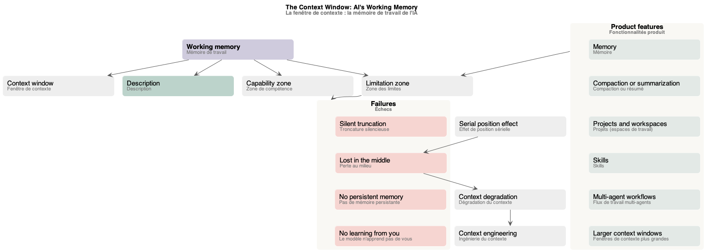
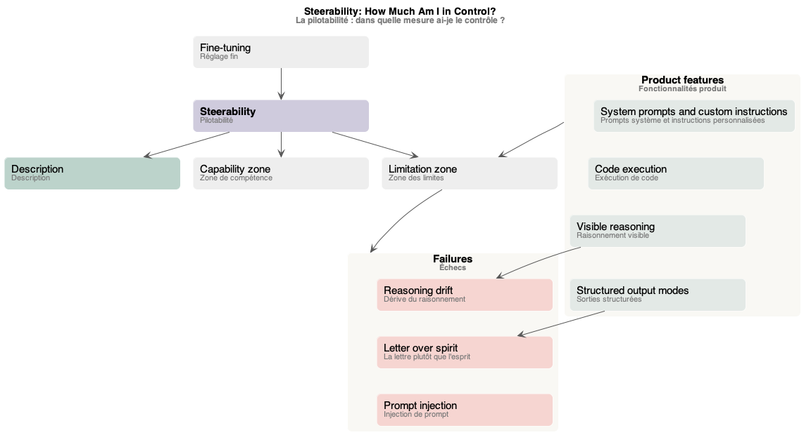
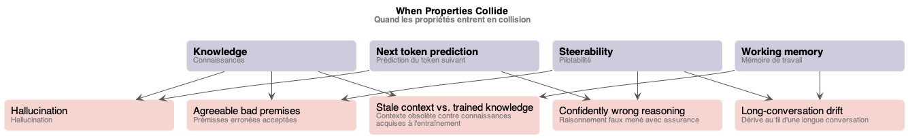
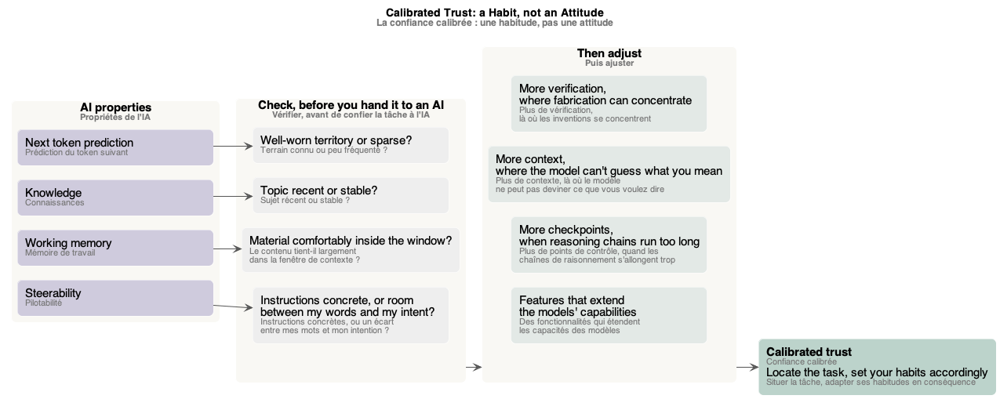

# Schémas du cours « AI Capabilities and Limitations »

Les schémas du [glossaire](index.md), un par partie du cours. Chacun est un fichier PlantUML (`.puml`, la source) rendu en `.png` et `.svg`, dans `mindmap/`.

## Sommaire

1. [Schéma des 4D](#schéma-des-4d)
2. [Schéma de la personnalité de l'IA](#schéma-de-la-personnalité-de-lia)
3. [Schéma de la prédiction du token suivant](#schéma-de-la-prédiction-du-token-suivant)
4. [Schéma des connaissances](#schéma-des-connaissances)
5. [Schéma de la mémoire de travail](#schéma-de-la-mémoire-de-travail)
6. [Schéma de la pilotabilité](#schéma-de-la-pilotabilité)
7. [Schéma des collisions](#schéma-des-collisions)
8. [Schéma de la confiance calibrée](#schéma-de-la-confiance-calibrée)

## Schéma des 4D

*Les 4D (compétences humaines), chacun face à sa propriété de l'IA, et ce qui en découle : la fenêtre de contexte, la lacune, l'hallucination, la dérive au fil d'une longue conversation.* Source : [four-properties.puml](mindmap/four-properties.puml)

## Schéma de la personnalité de l'IA

*D'où vient la personnalité de l'IA : préentraînement, réglage fin, et la part d'ombre d'une IA serviable (complaisance, verbosité, excès de prudence, mauvaise calibration de la confiance).* Source : [ai-character.puml](mindmap/ai-character.puml)

## Schéma de la prédiction du token suivant

*L'autocomplétion à grande échelle : la prédiction du token suivant, l'échantillonnage et ses paramètres, ses défaillances, et les fonctionnalités produit qui repoussent la frontière.* Source : [next-token-prediction.puml](mindmap/next-token-prediction.puml)

## Schéma des connaissances

*Ce que le modèle a lu, et quand il a cessé de lire : les connaissances issues des données d'entraînement, les embeddings et la recherche de similarité, les défaillances (dont la date limite des connaissances) et les fonctionnalités produit.* Source : [knowledge.puml](mindmap/knowledge.puml)

## Schéma de la mémoire de travail

*La fenêtre de contexte, mémoire de travail de l'IA : l'effet de position sérielle, la dégradation et l'ingénierie du contexte, ses défaillances et les fonctionnalités produit.* Source : [working-memory.puml](mindmap/working-memory.puml)

## Schéma de la pilotabilité

*Dans quelle mesure ai-je le contrôle ? La pilotabilité, issue du réglage fin, sa zone de compétence et sa zone des limites, ses défaillances et les fonctionnalités produit.* Source : [steerability.puml](mindmap/steerability.puml)

## Schéma des collisions

*Quand les propriétés entrent en collision : les cinq collisions du cours, chacune la rencontre de deux propriétés.* Source : [collisions.puml](mindmap/collisions.puml)

## Schéma de la confiance calibrée

*La confiance calibrée, une habitude et pas une attitude : une question par propriété avant de confier la tâche à l'IA, puis l'ajustement qui y répond.* Source : [calibrated-trust.puml](mindmap/calibrated-trust.puml)
