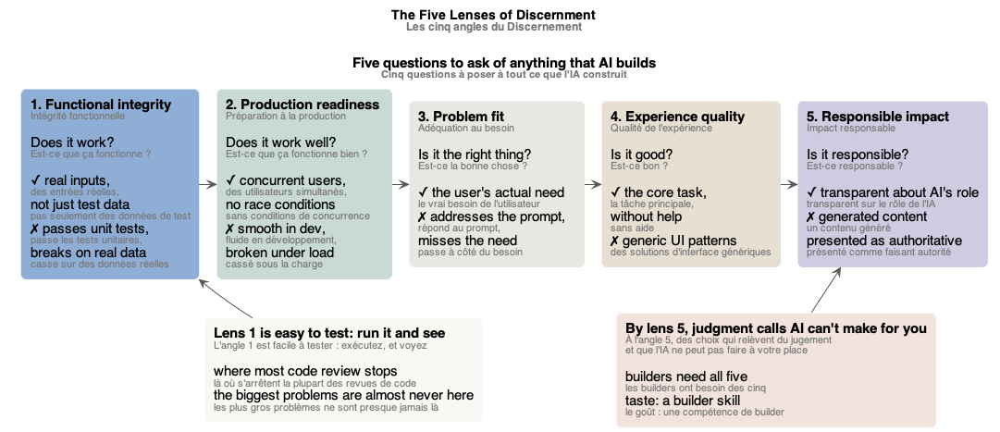
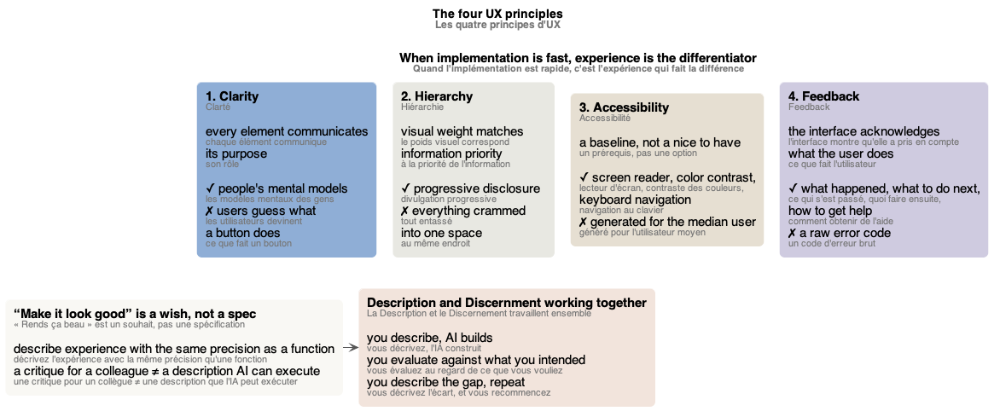
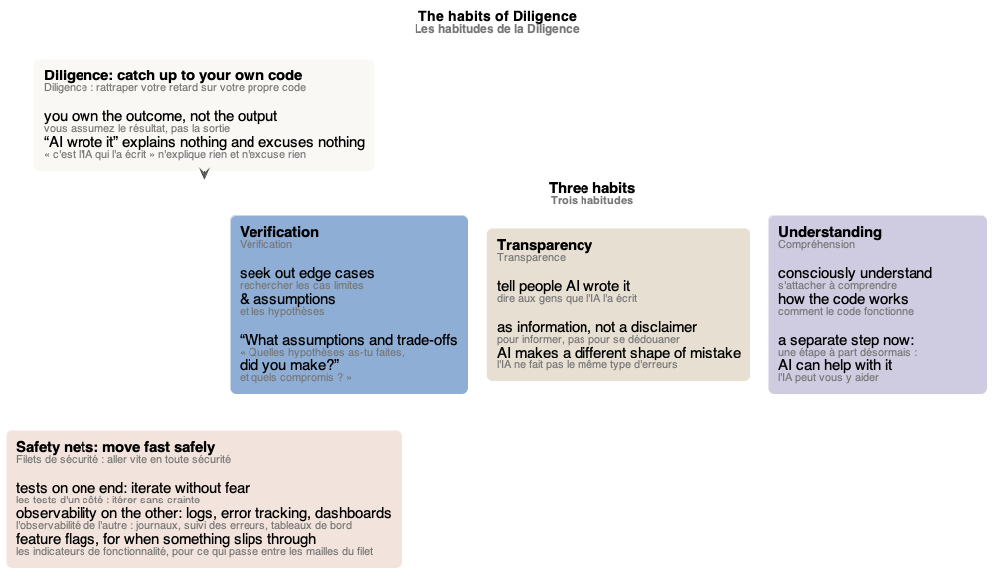

# Schémas du cours « AI Fluency for Builders »

Les schémas du [glossaire](index.md), un par partie du cours. Chacun est un fichier PlantUML (`.puml`, la source) rendu en `.png` et `.svg`, dans `mindmap/`.

## Sommaire

1. [Schéma des 4D du builder](#schéma-des-4d-du-builder)
2. [Schéma des trois piliers de l'IA générative](#schéma-des-trois-piliers-de-lia-générative)
3. [Schéma de la boîte à outils du builder](#schéma-de-la-boîte-à-outils-du-builder)
4. [Schéma de la chaîne de Description](#schéma-de-la-chaîne-de-description)
5. [Schéma des cinq angles du Discernement](#schéma-des-cinq-angles-du-discernement)
6. [Schéma des principes d'UX](#schéma-des-principes-dux)
7. [Schéma des habitudes de la Diligence](#schéma-des-habitudes-de-la-diligence)

## Schéma des 4D du builder

*Le builder assume tout le parcours, du problème client à la solution livrée ; le cadre 4D, ce que chaque compétence lui demande ; et l'IA, un collaborateur compétent mais très littéral.* Source : [builder-4ds.puml](mindmap/builder-4ds.puml)

## Schéma des trois piliers de l'IA générative

*Les algorithmes, les données et la puissance de calcul, réunis, ont mené à la découverte des lois d'échelle ; à mesure que les modèles grandissaient, des capacités que personne n'avait programmées sont apparues.* Source : [three-pillars.puml](mindmap/three-pillars.puml)

## Schéma de la boîte à outils du builder

*Les six capacités du builder, dans l'ordre d'un projet : l'IA est la plus forte au milieu, pour l'implémentation, et la plus faible aux extrémités, là où se trouvent le travail humain et la valeur ; les tests d'acceptation définissent « terminé » avant le code.* Source : [builders-toolkit.puml](mindmap/builders-toolkit.puml)

## Schéma de la chaîne de Description

*Les quatre étapes, de la voix de l'utilisateur à l'instruction pour l'IA, avec le builder pour traducteur à chaque étape ; une erreur de Description (le code fonctionne, pas le produit) se trace jusqu'au maillon qui a cédé ; les tests, la forme de description la plus précise, accompagnent le prompt.* Source : [description-chain.puml](mindmap/description-chain.puml)

## Schéma des cinq angles du Discernement

*Cinq questions à poser à tout ce que l'IA construit, chacune avec ce qu'elle vérifie (✓) et l'échec courant de l'IA (✗) : l'angle 1 est facile à tester, mais les plus gros problèmes ne s'y trouvent presque jamais ; à l'angle 5, des choix qui relèvent du jugement et que l'IA ne peut pas faire à votre place.* Source : [five-lenses.puml](mindmap/five-lenses.puml)

## Schéma des principes d'UX

*Les quatre principes d'UX, chacun avec ce qu'il demande (✓) et le défaut de l'IA (✗) ; « rends ça beau » est un souhait, pas une spécification : la Description et le Discernement travaillent ensemble, vous décrivez, l'IA construit, vous évaluez, et vous recommencez.* Source : [ux-principles.puml](mindmap/ux-principles.puml)

## Schéma des habitudes de la Diligence

*Avec l'IA, vous pouvez finir par être responsable d'un code que vous n'avez pas écrit : la Diligence, c'est rattraper votre retard sur lui, par trois habitudes (la vérification, la transparence, la compréhension) ; les filets de sécurité, les tests d'un côté et l'observabilité de l'autre, vous permettent d'aller vite en toute sécurité.* Source : [diligence-habits.puml](mindmap/diligence-habits.puml)
