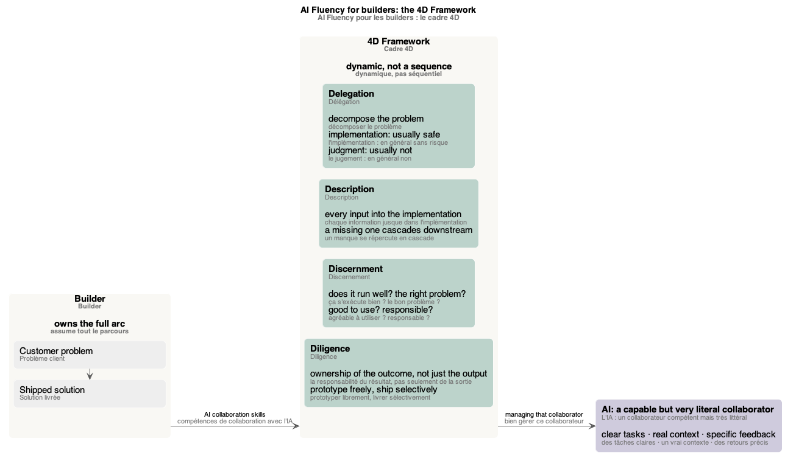
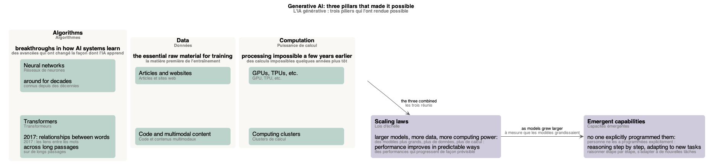
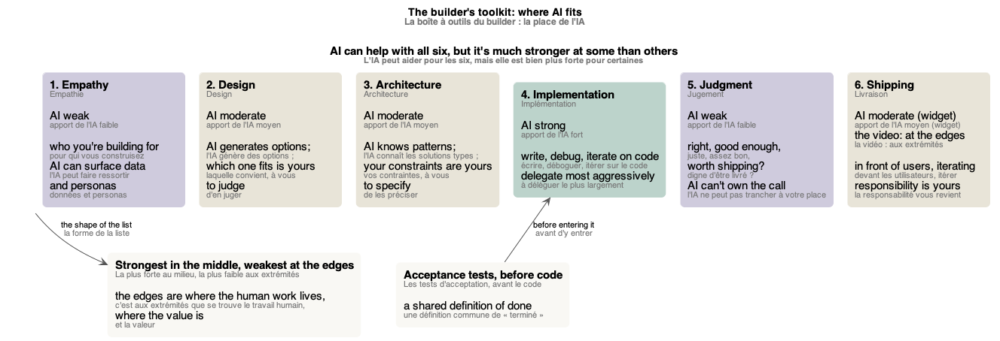
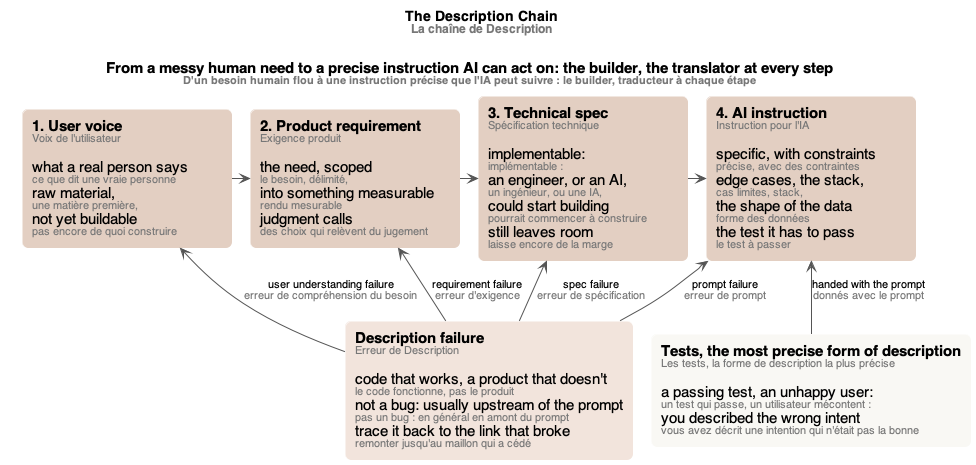

# Schémas du cours « AI Fluency for Builders »

Les schémas du [glossaire](index.md), un par partie du cours. Chacun est un fichier PlantUML (`.puml`, la source) rendu en `.png` et `.svg`, dans `mindmap/`.

## Sommaire

1. [Schéma des 4D du builder](#schéma-des-4d-du-builder)
2. [Schéma des trois piliers de l'IA générative](#schéma-des-trois-piliers-de-lia-générative)
3. [Schéma de la boîte à outils du builder](#schéma-de-la-boîte-à-outils-du-builder)
4. [Schéma de la chaîne de Description](#schéma-de-la-chaîne-de-description)

## Schéma des 4D du builder

*Le builder assume tout le parcours, du problème client à la solution livrée ; le cadre 4D, ce que chaque compétence lui demande ; et l'IA, un collaborateur compétent mais très littéral.* Source : [builder-4ds.puml](mindmap/builder-4ds.puml)

## Schéma des trois piliers de l'IA générative

*Les algorithmes, les données et la puissance de calcul, réunis, ont mené à la découverte des lois d'échelle ; à mesure que les modèles grandissaient, des capacités que personne n'avait programmées sont apparues.* Source : [three-pillars.puml](mindmap/three-pillars.puml)

## Schéma de la boîte à outils du builder

*Les six capacités du builder, dans l'ordre d'un projet : l'IA est la plus forte au milieu, pour l'implémentation, et la plus faible aux extrémités, là où se trouvent le travail humain et la valeur ; les tests d'acceptation définissent « terminé » avant le code.* Source : [builders-toolkit.puml](mindmap/builders-toolkit.puml)

## Schéma de la chaîne de Description

*Les quatre étapes, de la voix de l'utilisateur à l'instruction pour l'IA, avec le builder pour traducteur à chaque étape ; une erreur de Description (le code fonctionne, pas le produit) se trace jusqu'au maillon qui a cédé ; les tests, la forme de description la plus précise, accompagnent le prompt.* Source : [description-chain.puml](mindmap/description-chain.puml)
