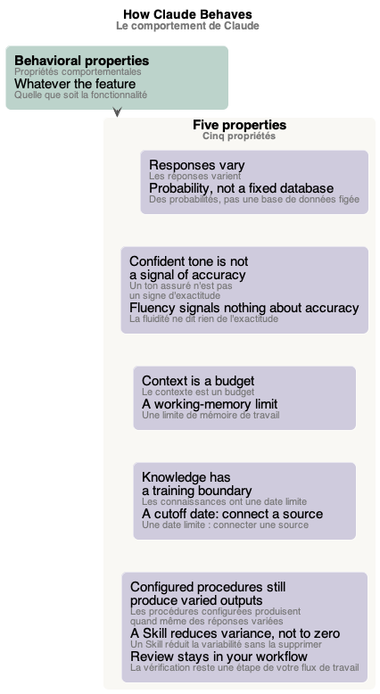
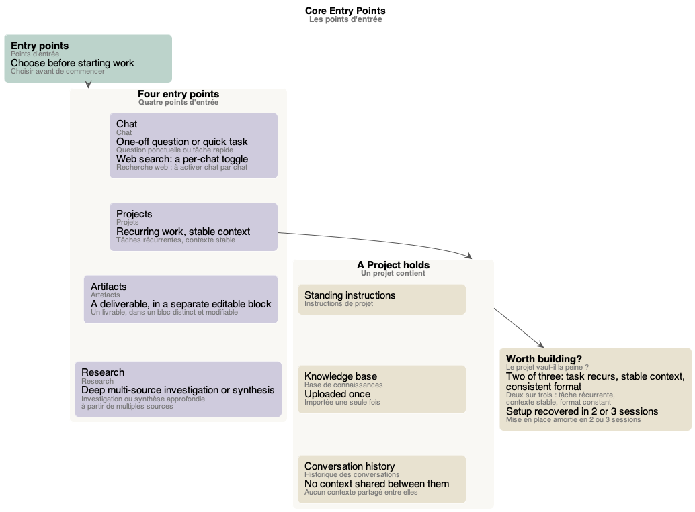
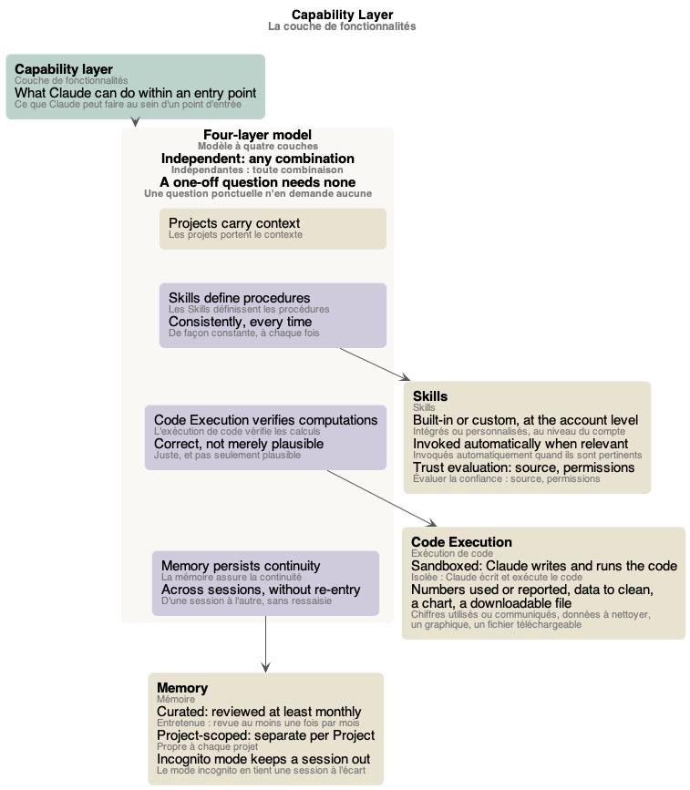

# Schémas du cours « Claude Platform and Model Foundations »

Les schémas du [glossaire](index.md), un par partie du cours. Chacun est un fichier PlantUML (`.puml`, la source) rendu en `.png` et `.svg`, dans `mindmap/`.

## Sommaire

1. [Schéma des propriétés comportementales](#schéma-des-propriétés-comportementales)
2. [Schéma des points d'entrée](#schéma-des-points-dentrée)
3. [Schéma de la couche de fonctionnalités](#schéma-de-la-couche-de-fonctionnalités)

## Schéma des propriétés comportementales

*Le comportement de Claude : cinq propriétés qui valent quelle que soit la fonctionnalité (les réponses varient, un ton assuré n'est pas un signe d'exactitude, le contexte est un budget, les connaissances ont une date limite, les procédures configurées produisent quand même des réponses variées).* Source : [behavioral-properties.puml](mindmap/behavioral-properties.puml)

## Schéma des points d'entrée

*Les quatre points d'entrée de Claude, à choisir avant de commencer (le chat, les projets, les artefacts, Research) et la tâche de chacun ; ce que contient un projet (instructions de projet, base de connaissances, historique des conversations) et quand il vaut la peine d'être créé (deux conditions sur trois).* Source : [entry-points.puml](mindmap/entry-points.puml)

## Schéma de la couche de fonctionnalités

*Ce que Claude peut faire au sein d'un point d'entrée : le modèle à quatre couches (les projets, les Skills, l'exécution de code, la mémoire), indépendantes ; puis ce qui distingue chaque fonctionnalité (Skills intégrés ou personnalisés et leur évaluation de confiance, l'exécution de code isolée et ses usages, la mémoire entretenue, propre à chaque projet, et le mode incognito).* Source : [capability-layer.puml](mindmap/capability-layer.puml)
