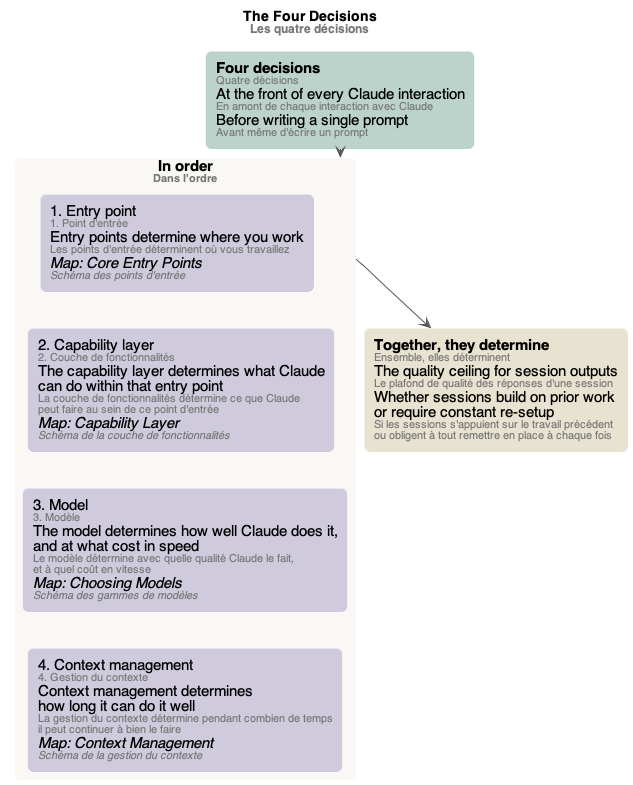
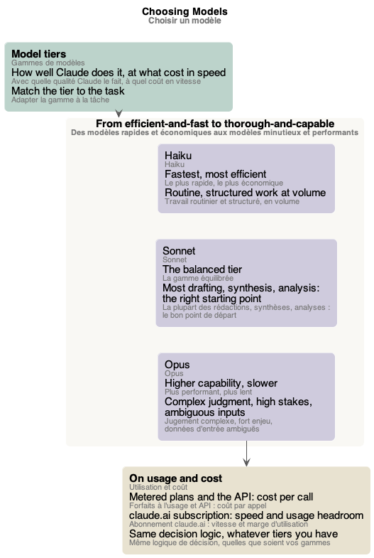
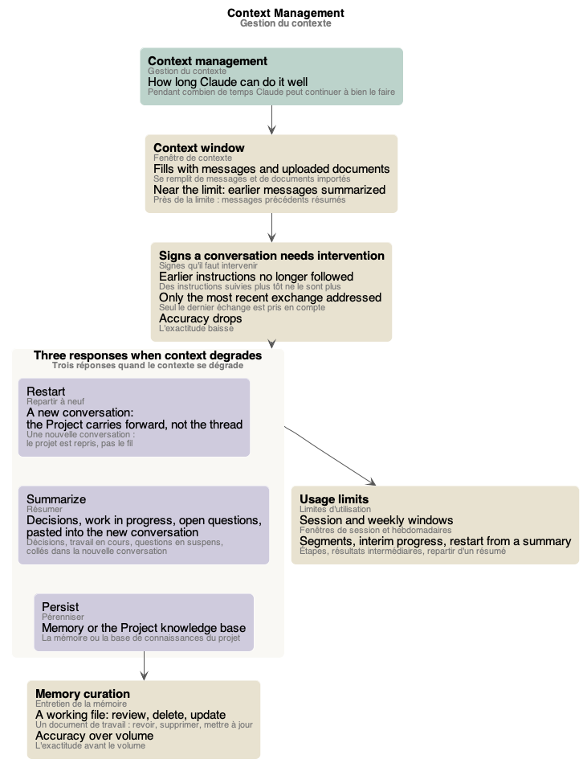

# Schémas du cours « Claude Platform and Model Foundations »

Les schémas du [glossaire](index.md), un par partie du cours. Chacun est un fichier PlantUML (`.puml`, la source) rendu en `.png` et `.svg`, dans `mindmap/`.

## Sommaire

1. [Schéma des quatre décisions](#schéma-des-quatre-décisions)
2. [Schéma des propriétés comportementales](#schéma-des-propriétés-comportementales)
3. [Schéma des points d'entrée](#schéma-des-points-dentrée)
4. [Schéma de la couche de fonctionnalités](#schéma-de-la-couche-de-fonctionnalités)
5. [Schéma des gammes de modèles](#schéma-des-gammes-de-modèles)
6. [Schéma de la gestion du contexte](#schéma-de-la-gestion-du-contexte)

## Schéma des quatre décisions

*Les quatre décisions qui interviennent en amont de chaque interaction avec Claude, dans l'ordre (le point d'entrée, la couche de fonctionnalités, le modèle, la gestion du contexte), ce que chacune détermine et le schéma qui la détaille ; ensemble, elles déterminent le plafond de qualité des réponses d'une session, et si les sessions s'appuient sur le travail précédent ou obligent à tout remettre en place à chaque fois.* Source : [four-decisions.puml](mindmap/four-decisions.puml)

## Schéma des propriétés comportementales

*Le comportement de Claude : cinq propriétés qui valent quelle que soit la fonctionnalité (les réponses varient, un ton assuré n'est pas un signe d'exactitude, le contexte est un budget, les connaissances ont une date limite, les procédures configurées produisent quand même des réponses variées).* Source : [behavioral-properties.puml](mindmap/behavioral-properties.puml)

## Schéma des points d'entrée

*Les quatre points d'entrée de Claude, à choisir avant de commencer (le chat, les projets, les artefacts, Research) et la tâche de chacun ; ce que contient un projet (instructions de projet, base de connaissances, historique des conversations) et quand il vaut la peine d'être créé (deux conditions sur trois).* Source : [entry-points.puml](mindmap/entry-points.puml)

## Schéma de la couche de fonctionnalités

*Ce que Claude peut faire au sein d'un point d'entrée : le modèle à quatre couches (les projets, les Skills, l'exécution de code, la mémoire), indépendantes ; puis ce qui distingue chaque fonctionnalité (Skills intégrés ou personnalisés, et s'il faut leur faire confiance, l'exécution de code isolée et ses usages, la mémoire entretenue, propre à chaque projet, et le mode incognito).* Source : [capability-layer.puml](mindmap/capability-layer.puml)

## Schéma des gammes de modèles

*Choisir un modèle : adapter la gamme à la tâche, des modèles rapides et économiques aux modèles minutieux et performants (Haiku, Sonnet, Opus) et la tâche de chacun ; sur les forfaits à l'usage et l'API, le coût par appel ; sur l'abonnement claude.ai, la vitesse et la marge d'utilisation.* Source : [model-tiers.puml](mindmap/model-tiers.puml)

## Schéma de la gestion du contexte

*Gérer le contexte : pendant combien de temps Claude peut continuer à bien travailler ; la fenêtre de contexte qui se remplit, les signes qu'il faut intervenir, les trois réponses quand le contexte se dégrade (repartir à neuf, résumer, pérenniser) ; l'entretien de la mémoire et les limites d'utilisation.* Source : [context-management.puml](mindmap/context-management.puml)
