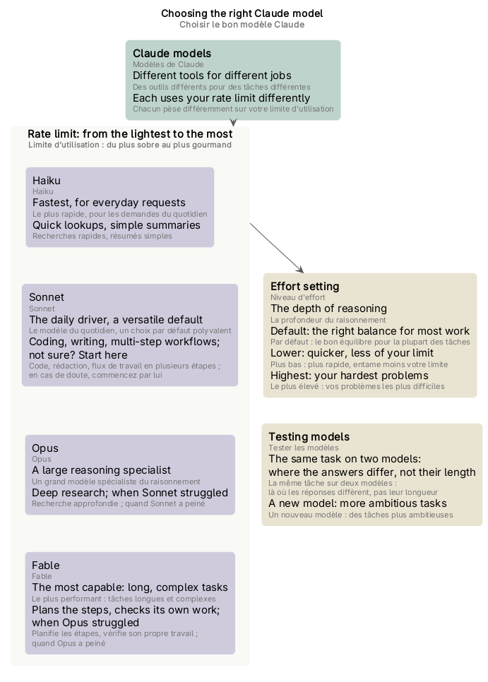

# Schémas du cours « Choosing the right Claude model »

Les schémas du [glossaire](index.md), un par partie du cours. Chacun est un fichier PlantUML (`.puml`, la source) rendu en `.png` et `.svg`, dans `mindmap/`.

## Sommaire

1. [Schéma des quatre modèles](#schéma-des-quatre-modèles)

## Schéma des quatre modèles

*Les quatre modèles de Claude, du plus sobre au plus gourmand sur la limite d'utilisation (Haiku, Sonnet, Opus, Fable), ce que chacun est et quand le choisir ; le niveau d'effort, qui règle la profondeur du raisonnement ; tester les modèles (la même tâche sur deux modèles, des tâches plus ambitieuses à chaque nouveau modèle).* Source : [four-models.puml](mindmap/four-models.puml)
