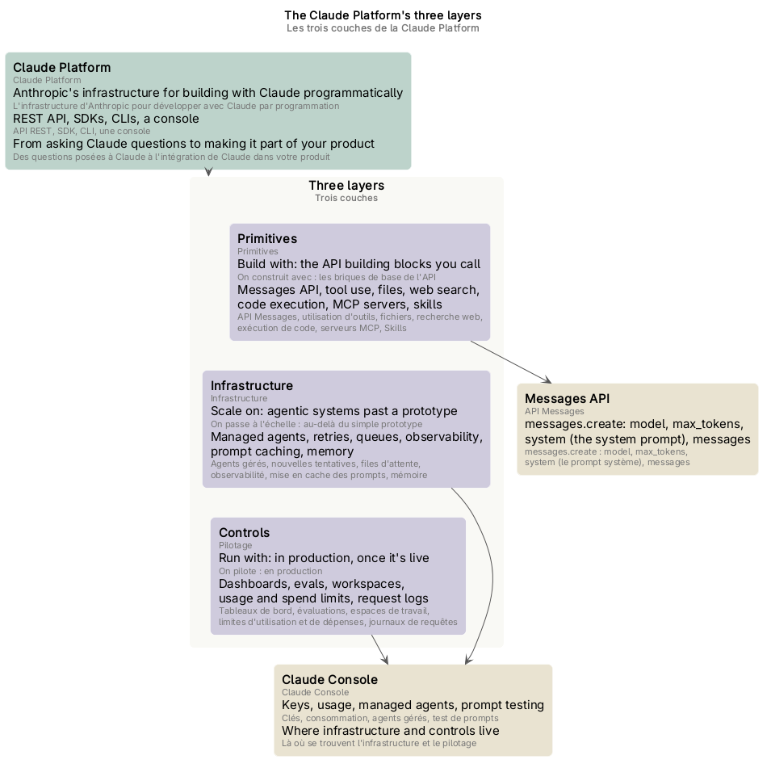
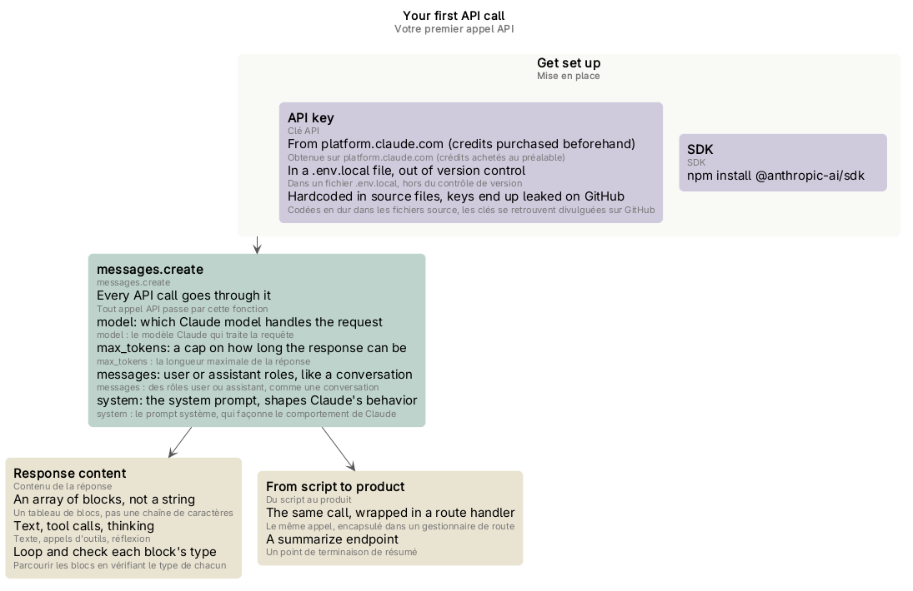
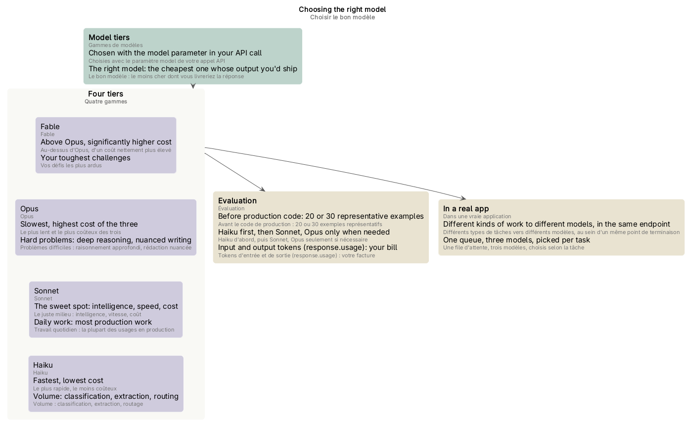
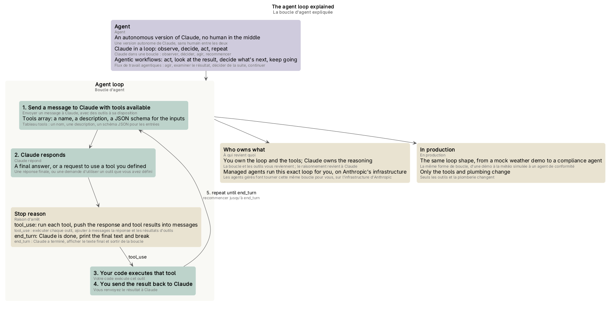
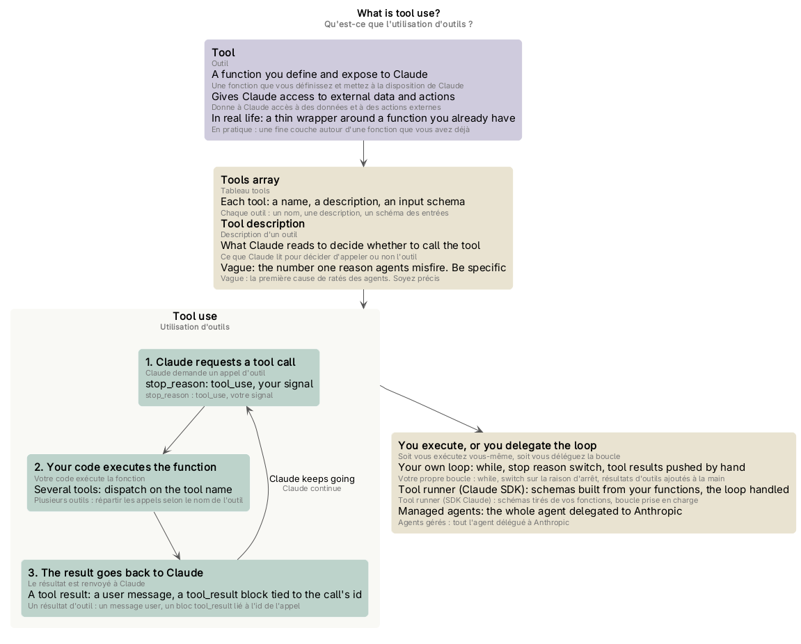
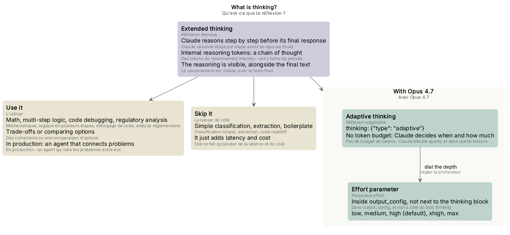
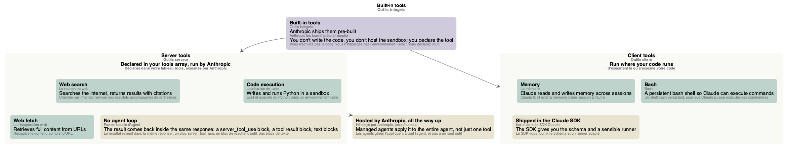

# Schémas du cours « Claude Platform 101 »

Les schémas du [glossaire](index.md), un par partie du cours. Chacun est un fichier PlantUML (`.puml`, la source) rendu en `.png` et `.svg`, dans `mindmap/`.

## Sommaire

1. [Schéma des trois couches](#schéma-des-trois-couches)
2. [Schéma du premier appel API](#schéma-du-premier-appel-api)
3. [Schéma du choix du modèle](#schéma-du-choix-du-modèle)
4. [Schéma de la boucle d'agent](#schéma-de-la-boucle-dagent)
5. [Schéma de l'utilisation d'outils](#schéma-de-lutilisation-doutils)
6. [Schéma de la réflexion](#schéma-de-la-réflexion)
7. [Schéma des outils intégrés](#schéma-des-outils-intégrés)

## Schéma des trois couches

*La Claude Platform, l'infrastructure d'Anthropic pour développer avec Claude par programmation, et ses trois couches : les primitives (on construit avec : l'API Messages et les autres briques de base de l'API), l'infrastructure (on passe à l'échelle : les agents gérés, les nouvelles tentatives, les files d'attente) et le pilotage (on pilote en production : les tableaux de bord, les évaluations) ; l'appel à messages.create et ses paramètres ; la Claude Console, où se trouvent l'infrastructure et le pilotage.* Source : [three-layers.puml](mindmap/three-layers.puml)

## Schéma du premier appel API

*Votre premier appel API : la mise en place (la clé API, obtenue sur platform.claude.com et rangée dans un fichier .env.local, hors du contrôle de version ; le SDK), l'appel à messages.create et ce que vous y indiquez (model, max_tokens, messages aux rôles user ou assistant, system pour le prompt système), le contenu de la réponse (un tableau de blocs : texte, appels d'outils, réflexion), puis le même appel dans un gestionnaire de route, au cœur d'un produit.* Source : [first-api-call.puml](mindmap/first-api-call.puml)

## Schéma du choix du modèle

*Choisir le bon modèle : les gammes de modèles, choisies avec le paramètre model de l'appel API, et le bon modèle, le moins cher dont vous livreriez la réponse ; les quatre gammes (Fable au-dessus d'Opus ; Opus pour les problèmes difficiles ; Sonnet, le juste milieu, pour le travail quotidien ; Haiku pour le volume) ; l'évaluation, de Haiku vers le haut, et les tokens d'entrée et de sortie sur lesquels la facture est calculée ; dans une vraie application, chaque type de tâche routé vers un modèle, au sein d'un même point de terminaison.* Source : [choosing-a-model.puml](mindmap/choosing-a-model.puml)

## Schéma de la boucle d'agent

*La boucle d'agent : l'agent, une version autonome de Claude, sans humain entre les deux (Claude dans une boucle : observer, décider, agir, recommencer ; les flux de travail agentiques) ; les étapes de la boucle (envoyer un message avec des outils à disposition, le tableau tools et ses trois parties ; la réponse de Claude ; votre code exécute l'outil et renvoie le résultat), selon la raison d'arrêt (tool_use : on recommence ; end_turn : Claude a terminé) ; à qui revient quoi (la boucle et les outils à vous, le raisonnement à Claude, ou les agents gérés qui font tourner cette même boucle pour vous) ; la même forme de boucle en production, où seuls les outils et la plomberie changent.* Source : [agent-loop.puml](mindmap/agent-loop.puml)

## Schéma de l'utilisation d'outils

*L'utilisation d'outils : l'outil, une fonction que vous définissez et mettez à la disposition de Claude, qui lui donne accès à des données et à des actions externes (en pratique, une fine couche autour d'une fonction que vous avez déjà) ; le tableau tools (un nom, une description, un schéma des entrées par outil) et la description d'un outil, que Claude lit pour décider de l'appeler ; les trois temps (Claude demande un appel d'outil, votre code exécute la fonction, le résultat d'outil est renvoyé à Claude, qui continue) ; soit vous exécutez vous-même, soit vous déléguez la boucle : votre propre boucle, le tool runner du SDK, ou les agents gérés, qui délèguent tout l'agent à Anthropic.* Source : [tool-use.puml](mindmap/tool-use.puml)

## Schéma de la réflexion

*La réflexion étendue : Claude raisonne étape par étape avant sa réponse finale, avec des tokens de raisonnement internes (une chaîne de pensée), et le raisonnement est visible dans la réponse, avec le texte final ; avec Opus 4.7, la réflexion adaptative (thinking: {"type": "adaptive"}, pas de budget de tokens : Claude décide quand réfléchir, et dans quelle mesure) et le paramètre effort, dans output_config, qui en règle la profondeur (low, medium, high par défaut, xhigh, max) ; quand l'utiliser (les mathématiques, la logique en plusieurs étapes, le débogage de code, l'analyse réglementaire, les compromis ; en production, un agent qui relie les problèmes entre eux) et quand la laisser de côté (la classification simple, l'extraction, le code répétitif : elle ne fait qu'ajouter de la latence et du coût).* Source : [thinking.puml](mindmap/thinking.puml)

## Schéma des outils intégrés

*Les outils intégrés : des capacités qu'Anthropic fournit prêtes à l'emploi (vous n'écrivez pas le code, vous n'hébergez pas l'environnement isolé : vous déclarez l'outil) ; les outils serveur, déclarés dans votre tableau tools et exécutés par Anthropic (la recherche web, l'exécution de code, la récupération web), sans boucle d'agent : le résultat revient dans la même réponse, avec un bloc server_tool_use ; les outils client, qui s'exécutent là où s'exécute votre code (la mémoire, bash), avec le schéma et un runner fournis par le SDK ; l'idée « hébergé par Anthropic » va jusqu'au bout, avec les agents gérés qui l'appliquent à tout l'agent.* Source : [built-in-tools.puml](mindmap/built-in-tools.puml)
