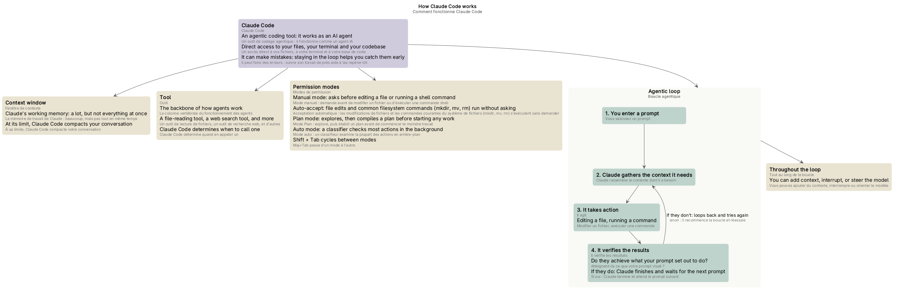
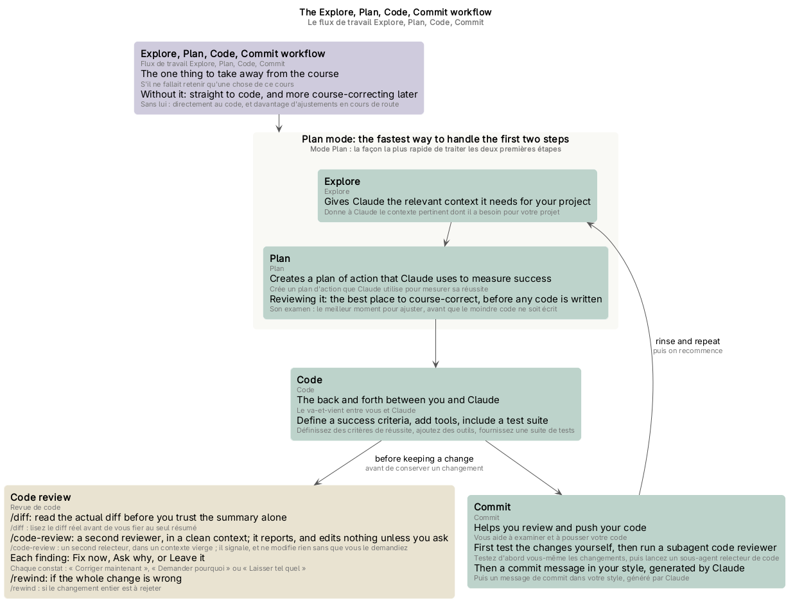
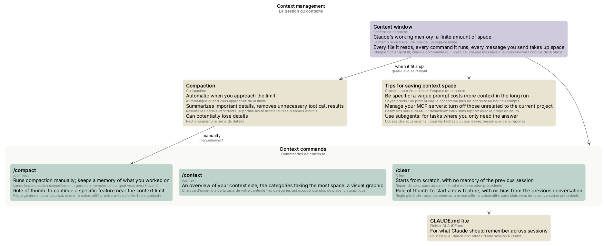
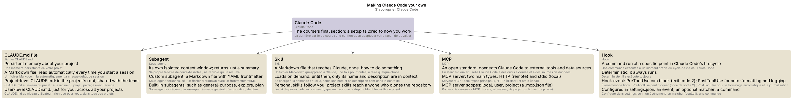

# Schémas du cours « Claude Code 101 »

Les schémas du [glossaire](index.md), un par partie du cours. Chacun est un fichier PlantUML (`.puml`, la source) rendu en `.png` et `.svg`, dans `mindmap/`.

## Sommaire

1. [Schéma du fonctionnement de Claude Code](#schéma-du-fonctionnement-de-claude-code)
2. [Schéma du flux de travail](#schéma-du-flux-de-travail)
3. [Schéma de la gestion du contexte](#schéma-de-la-gestion-du-contexte)
4. [Schéma de la personnalisation de Claude Code](#schéma-de-la-personnalisation-de-claude-code)

## Schéma du fonctionnement de Claude Code

*Claude Code, un outil de codage agentique qui fonctionne comme un agent IA ; la boucle agentique (un prompt, rassembler le contexte, agir, vérifier les résultats ; s'ils sont bons, attendre le prompt suivant, sinon recommencer), que l'on peut orienter à tout moment ; la fenêtre de contexte, les outils et les quatre modes de permission.* Source : [how-claude-code-works.puml](mindmap/how-claude-code-works.puml)

## Schéma du flux de travail

*Le flux de travail Explore, Plan, Code, Commit, celui qu'il faut retenir s'il ne fallait retenir qu'une chose de ce cours : ce que fait chaque étape, le mode Plan pour les deux premières, l'examen du plan comme meilleur moment pour ajuster ; la revue de code avant de conserver un changement (/diff, /code-review, les trois piles de constats, /rewind).* Source : [workflow.puml](mindmap/workflow.puml)

## Schéma de la gestion du contexte

*La fenêtre de contexte et ce qui la remplit ; la compaction, automatique près de la limite ; les trois commandes de contexte (/compact, /clear, /context) et la règle générale pour choisir entre /compact et /clear ; les trois conseils pour économiser l'espace de contexte ; le fichier CLAUDE.md pour ce qui doit durer d'une session à l'autre.* Source : [context-management.puml](mindmap/context-management.puml)

## Schéma de la personnalisation de Claude Code

*La dernière partie du cours, s'approprier Claude Code : le fichier CLAUDE.md (mémoire persistante, deux niveaux), les sous-agents (personnalisés, intégrés), les skills (personnels, de projet), MCP (serveurs HTTP et stdio, trois portées) et les hooks (déterministes : événements, matcher, codes de sortie).* Source : [making-claude-code-your-own.puml](mindmap/making-claude-code-your-own.puml)
