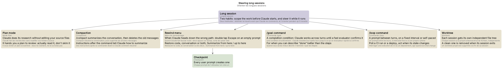
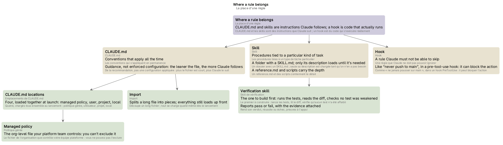
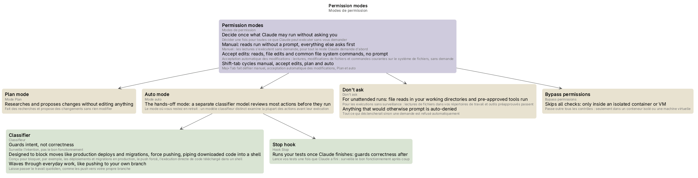
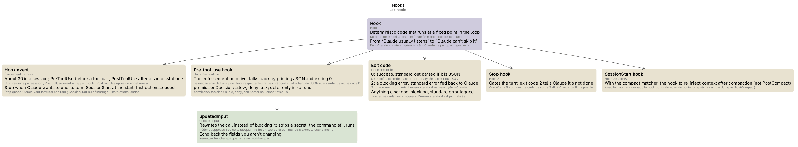
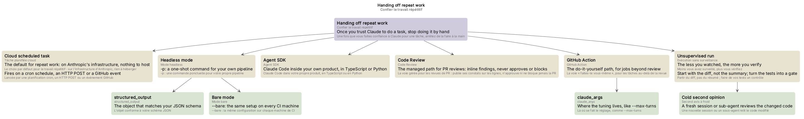
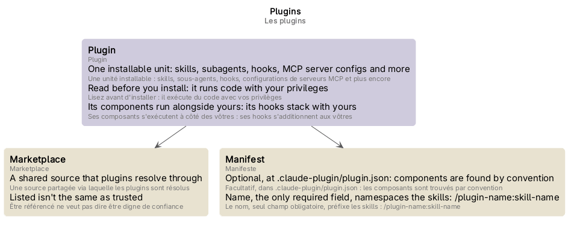

# Schémas du cours « Claude Code in Action »

Les schémas du [glossaire](index.md), un par partie du cours. Chacun est un fichier PlantUML (`.puml`, la source) rendu en `.png` et `.svg`, dans `mindmap/`.

## Sommaire

1. [Schéma de l'orientation des longues sessions](#schéma-de-lorientation-des-longues-sessions)
2. [Schéma de la place d'une règle](#schéma-de-la-place-dune-règle)
3. [Schéma des modes de permission](#schéma-des-modes-de-permission)
4. [Schéma des hooks](#schéma-des-hooks)
5. [Schéma du travail répétitif confié](#schéma-du-travail-répétitif-confié)
6. [Schéma des plugins](#schéma-des-plugins)

## Schéma de l'orientation des longues sessions

*Les deux habitudes d'une longue session : délimiter le travail d'abord (le mode Plan), puis orienter Claude pendant qu'il travaille (la compaction, le menu de rembobinage et ses checkpoints) ; le laisser travailler de façon plus autonome (les commandes /goal et /loop) ; mener un travail en parallèle (les worktrees).* Source : [steering-long-sessions.puml](mindmap/steering-long-sessions.puml)

## Schéma de la place d'une règle

*Les trois places d'une instruction : le fichier CLAUDE.md pour les conventions (ses quatre emplacements, la politique gérée, les imports), le skill pour les procédures (le skill de vérification, le premier à construire), le hook pour une règle que Claude ne doit pas pouvoir ignorer (« ne jamais pousser sur main », dans un hook PreToolUse).* Source : [where-a-rule-belongs.puml](mindmap/where-a-rule-belongs.puml)

## Schéma des modes de permission

*Les six modes de permission : manuel, acceptation automatique des modifications, Plan, auto (son classifieur, qui surveille l'intention, et le hook Stop, qui surveille le bon fonctionnement), Don't ask pour les exécutions sans surveillance, Bypass permissions dans un conteneur isolé.* Source : [permission-modes.puml](mindmap/permission-modes.puml)

## Schéma des hooks

*Le hook, du code déterministe : ses événements dans la boucle, le hook PreToolUse et sa décision en JSON (updatedInput pour réécrire un appel), les codes de sortie, le hook Stop qui contrôle la fin du tour, le hook SessionStart qui réinjecte du contexte après la compaction.* Source : [hooks.puml](mindmap/hooks.puml)

## Schéma du travail répétitif confié

*Du plus géré au plus intégré : la tâche planifiée cloud, le mode headless (structured_output, le mode bare), l'Agent SDK ; pour les pull requests, Code Review ou la GitHub Action (claude_args) ; puis la vérification d'une exécution sans surveillance et le second avis à froid.* Source : [unattended-work.puml](mindmap/unattended-work.puml)

## Schéma des plugins

*Le plugin, une unité installable : lire avant d'installer, ses composants à côté des vôtres ; la marketplace, par où passent les installations ; le manifeste, facultatif, dont le nom préfixe les skills.* Source : [plugins.puml](mindmap/plugins.puml)
