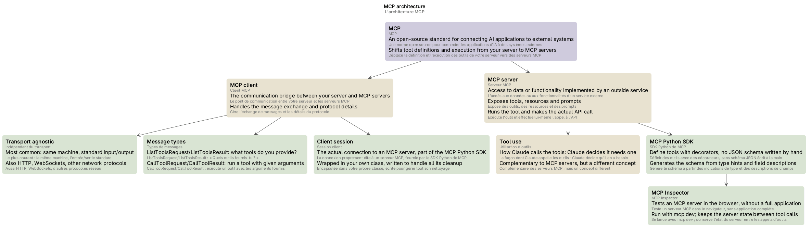

# Schémas du cours « Introduction to Model Context Protocol »

Les schémas du [glossaire](index.md), un par partie du cours. Chacun est un fichier PlantUML (`.puml`, la source) rendu en `.png` et `.svg`, dans `mindmap/`.

## Sommaire

1. [Schéma de l'architecture MCP](#schéma-de-larchitecture-mcp)

## Schéma de l'architecture MCP

*MCP et ses deux côtés : le client MCP (le pont de communication avec les serveurs MCP, indépendant du transport, ses types de messages ListTools et CallTool, sa session client) et le serveur MCP (l'accès à un service externe, ses outils, ressources et prompts, le SDK Python de MCP pour définir ses outils, et son MCP Inspector pour les tester), et l'utilisation d'outils à côté, complémentaire mais différente.* Source : [mcp-architecture.puml](mindmap/mcp-architecture.puml)
