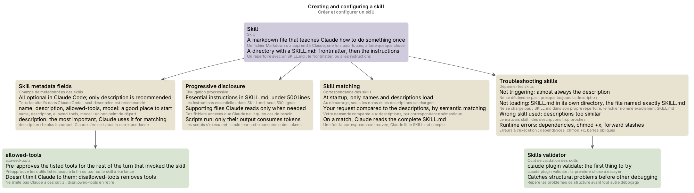
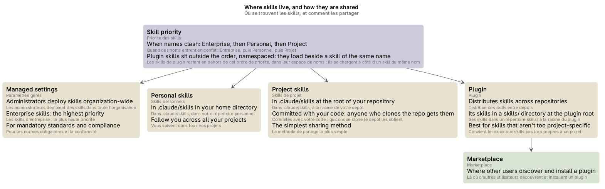
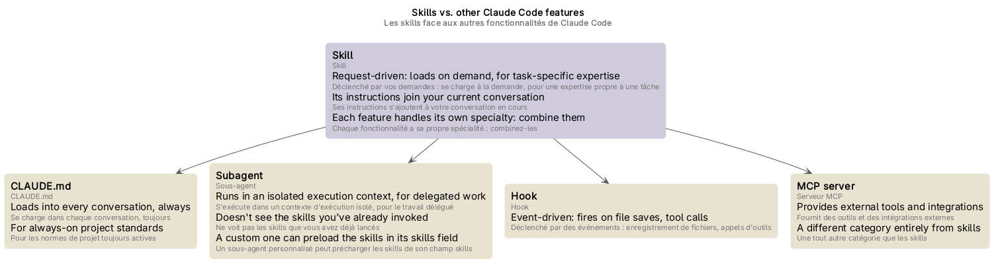

# Schémas du cours « Introduction to agent skills »

Les schémas du [glossaire](index.md), un par thème du cours. Chacun est un fichier PlantUML (`.puml`, la source) rendu en `.png` et `.svg`, dans `mindmap/`.

## Sommaire

1. [Schéma de la création d'un skill](#schéma-de-la-création-dun-skill)
2. [Schéma des emplacements et du partage des skills](#schéma-des-emplacements-et-du-partage-des-skills)
3. [Schéma des skills face aux autres fonctionnalités](#schéma-des-skills-face-aux-autres-fonctionnalités)

## Schéma de la création d'un skill

*Le skill (un fichier Markdown qui apprend à Claude, une fois pour toutes, à faire quelque chose ; un répertoire avec son SKILL.md), ses champs de métadonnées (tous facultatifs dans Claude Code, seul description est recommandé), dont allowed-tools (préapprouve des outils sans limiter Claude à ceux-là), la divulgation progressive (les fichiers annexes lus seulement en cas de besoin, les scripts exécutés), la correspondance des skills (les descriptions comparées à votre demande), et le dépannage, qui commence par l'outil de validation.* Source : [skill-anatomy.puml](mindmap/skill-anatomy.puml)

## Schéma des emplacements et du partage des skills

*La priorité des skills (entreprise, puis personnel, puis projet ; les skills de plugin en dehors de l'ordre), et les endroits d'où viennent les skills : les paramètres gérés (déployés dans toute l'organisation), les skills personnels, les skills de projet (commités dans le dépôt, la méthode de partage la plus simple) et les plugins, distribués sur une marketplace.* Source : [skill-locations.puml](mindmap/skill-locations.puml)

## Schéma des skills face aux autres fonctionnalités

*Les skills (déclenchés par vos demandes, chargés à la demande dans votre conversation) face aux autres fonctionnalités de Claude Code, chacune avec sa spécialité : CLAUDE.md (chargé dans chaque conversation), le sous-agent (qui s'exécute dans un contexte d'exécution isolé et ne voit pas les skills déjà lancés), le hook (déclenché par des événements) et le serveur MCP (des outils et des intégrations externes).* Source : [skills-and-other-features.puml](mindmap/skills-and-other-features.puml)
