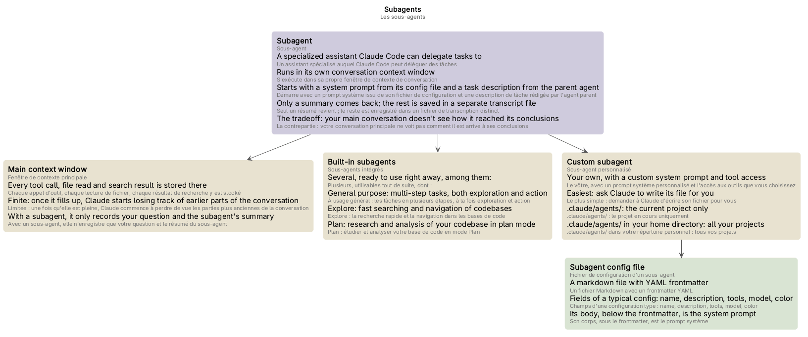
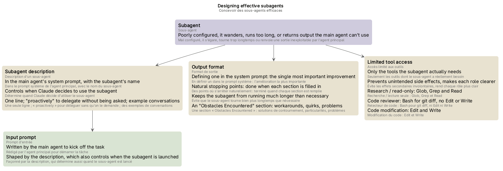
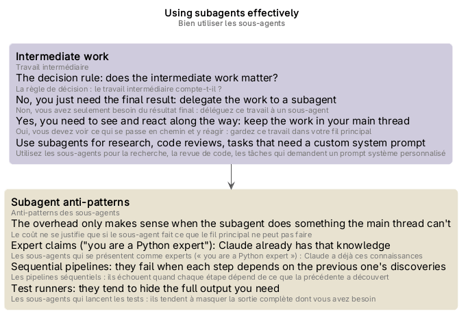

# Schémas du cours « Introduction to subagents »

Les schémas du [glossaire](index.md), un par thème du cours. Chacun est un fichier PlantUML (`.puml`, la source) rendu en `.png` et `.svg`, dans `mindmap/`.

## Sommaire

1. [Schéma des sous-agents](#schéma-des-sous-agents)
2. [Schéma de la conception des sous-agents](#schéma-de-la-conception-des-sous-agents)
3. [Schéma du bon usage des sous-agents](#schéma-du-bon-usage-des-sous-agents)

## Schéma des sous-agents

*Le sous-agent (un assistant spécialisé, dans sa propre fenêtre de contexte ; son prompt système et sa description de tâche au départ ; un résumé au retour, le reste dans un fichier de transcription distinct), la fenêtre de contexte principale qu'il garde propre, les sous-agents intégrés (parmi eux : à usage général, Explore, Plan), le sous-agent personnalisé et son fichier de configuration (ses champs, son corps : le prompt système).* Source : [subagents.puml](mindmap/subagents.puml)

## Schéma de la conception des sous-agents

*Les quatre caractéristiques des sous-agents efficaces : des descriptions précises (quand le sous-agent est lancé, et le prompt d'entrée qu'elles façonnent), une sortie structurée et le signalement des obstacles (tous deux dans le format de sortie : des points où s'arrêter naturellement, une section pour les obstacles), un accès limité aux outils, selon le type de sous-agent.* Source : [designing-subagents.puml](mindmap/designing-subagents.puml)

## Schéma du bon usage des sous-agents

*La règle de décision (le travail intermédiaire compte-t-il ?), là où les sous-agents excellent (la recherche, la revue de code, les tâches qui demandent un prompt système personnalisé) et leurs trois anti-patterns courants : les sous-agents qui se présentent comme experts, les pipelines séquentiels, les sous-agents qui lancent les tests.* Source : [using-subagents.puml](mindmap/using-subagents.puml)
